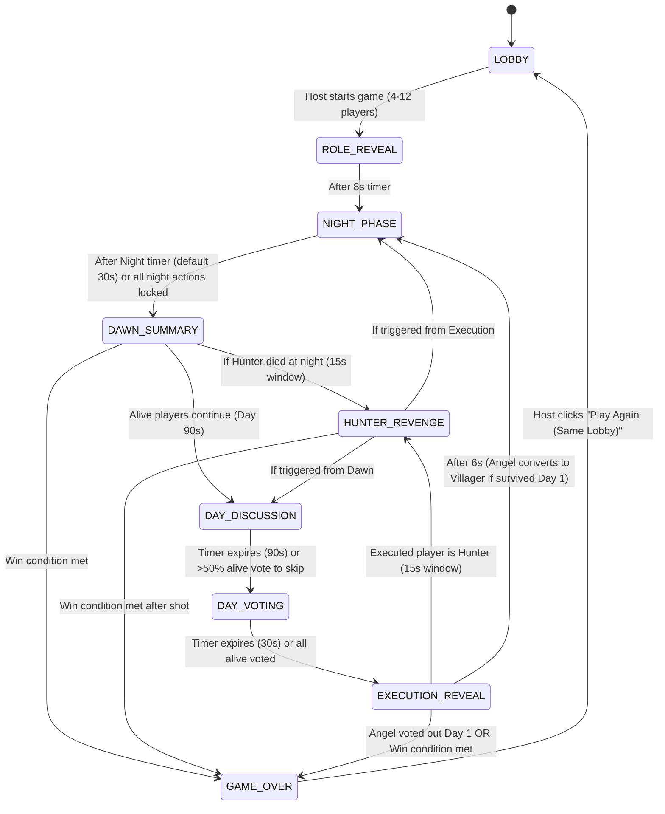

# Campfire Wolves — Architecture & Technical Specification

## 1. System Overview

**Campfire Wolves** is a full-stack, real-time multiplayer social deduction game for 4–12 players inspired by *Agrou* / *Werewolf*. The architecture is split into an authoritative Node.js + Express + Socket.io backend (`/server`) and a reactive Vite + React + TypeScript + Tailwind CSS + Framer Motion frontend (`/client`) inside a unified TypeScript monorepo.

```
agrou/
├── ARCHITECTURE.md
├── package.json              # Root workspace scripts (build, test, dev)
├── server/                   # Authoritative Node.js + Express + Socket.io server
│   ├── package.json
│   ├── tsconfig.json
│   ├── src/
│   │   ├── index.ts          # Express + Socket.io entrypoint
│   │   ├── types/            # Shared domain & socket contract types
│   │   ├── engine/           # State machine, sanitizer, win-condition & role strategies
│   │   │   ├── RoomManager.ts
│   │   │   ├── GameEngine.ts
│   │   │   ├── StateSanitizer.ts
│   │   │   ├── WinConditionChecker.ts
│   │   │   └── roles/        # Strategy/Command pattern per role
│   │   └── socket/           # Socket.io event handlers & WebRTC signaling
│   └── tests/                # Unit & integration tests for role resolution & security
└── client/                   # Vite + React + TypeScript + Tailwind + Framer Motion UI
    ├── package.json
    ├── tsconfig.json
    ├── index.html
    └── src/
        ├── main.tsx
        ├── App.tsx
        ├── types/            # Client-side sanitized state & event contracts
        ├── services/         # Socket.io client, Web Audio API synthesizer, session storage
        └── components/       # Campfire Arena, Role Cards, Chat, Audio Controls, Drawers
```

---

## 2. Deterministic Game State Machine

All phase transitions, timers, vote tallies, and role resolutions execute exclusively on the server. Each room maintains an authoritative `RoomState` and a single server-side interval/timeout ticker.

### Phase State Diagram



### Phase Specifications

| Phase | Default Duration | Server Responsibilities | Client Experience |
| :--- | :--- | :--- | :--- |
| `LOBBY` | Indefinite | Generate 5-char room code, manage player seats/avatars, validate role deck configuration & timers, allow adding bots for testing. | Copyable invite link, avatar/color picker, Host Role Deck & Timer settings panel. |
| `ROLE_REVEAL` | 8s | Shuffle deck, assign roles & initial state (`witchPotions`, `blackWolfUsed`, etc.), increment `dayNumber = 1`. | 3D Framer Motion card flip revealing player's secret Role, Faction, and Win Condition. |
| `NIGHT_PHASE` | 30s (configurable) | Accept Werewolf pack votes/chat, Little Girl peek ticks, Guard target, Seer inspect, Black Wolf infect toggle, Witch heal/poison, White Wolf solo kill. | Deep indigo moonlight theme; sleeping campfire for Villagers; interactive target selectors around the campfire for active night roles. |
| `DAWN_SUMMARY` | 8s | Resolve night actions via Strategy pipeline, apply deaths/conversions, reveal night casualties & their roles, check Hunter death, evaluate win conditions. | Sunrise transition, rooster crow audio, dramatic announcement of night casualties or peaceful night. |
| `DAY_DISCUSSION` | 90s (configurable) | Route alive messages to public chat, dead messages to Ghost Chat, track "End Discussion Early" votes (>50% alive threshold transitions early). | Warm orange campfire theme, public chat + Ghost chat tab, speaking/typing indicators, skip-to-vote button. |
| `DAY_VOTING` | 30s (configurable) | Record elimination votes or `SKIP` from alive players, broadcast live vote counts per seat, resolve plurality (ties = no elimination). | Click player seats around the campfire to vote; live vote badges next to avatars. |
| `EXECUTION_REVEAL` | 6s | Eliminate highest-voted player (if no tie), reveal their role, check Day 1 Angel win, check Hunter revenge, convert surviving Day 1 Angel to Villager, check win conditions. | Gavel sound effect, execution reveal banner, gravestone placement, Hunter revenge overlay if applicable. |
| `GAME_OVER` | Indefinite | Reveal full unmasked roles for all players, calculate MVP stats, persist match summary in memory/storage, allow resetting to `LOBBY`. | Full role reveal table, winning faction celebration, MVP badges, "Play Again" button. |

> **Hunter Revenge Sub-flow:** When the Hunter dies (either during `DAWN_SUMMARY` from night resolution or during `EXECUTION_REVEAL` from a day vote), the server sets `pendingHunterId` and grants a **15-second** window (`hunterRevengeEndsAt`) before advancing to the next phase. The dying Hunter selects any living player around the campfire to immediately eliminate.

---

## 3. Role Resolution Engine (Strategy / Command Pattern)

Each role implements the `RoleStrategy` interface on the backend:

```ts
export interface RoleStrategy {
  readonly role: RoleType;
  readonly faction: Faction;
  canActAtNight(room: RoomState, player: PlayerState): boolean;
  validateNightAction(room: RoomState, actor: PlayerState, action: NightActionPayload): ValidationResult;
  applyNightAction(context: NightResolutionContext, actor: PlayerState, action: NightActionPayload): void;
}
```

### Night Resolution Priority Order

During `NIGHT_PHASE`, players submit actions asynchronously (and Wolves vote on a pack victim, updating the current pack target so the Witch and Black Wolf can react). At the end of `NIGHT_PHASE`, `NightResolver.resolve(roomState)` executes deterministically in the following order:

1. **Guard Protection (`GUARD`)**
   - Marks `context.protectedPlayerIds.add(targetId)`.
   - Validation enforces `targetId !== guard.lastProtectedPlayerId`. Updates `guard.lastProtectedPlayerId = targetId`.
2. **Werewolf Pack Vote Tally (`WEREWOLF`, `BLACK_WOLF`, `WHITE_WOLF`)**
   - Counts votes from all living wolf-pack members (`WEREWOLF`, `BLACK_WOLF`, `WHITE_WOLF`).
   - Plurality determines `context.wolfVictimId` (ties among wolves resolve to the earliest-submitted top target, or `null` if no wolf voted).
3. **Black Wolf Infection (`BLACK_WOLF`)**
   - Once per game (`!room.blackWolfInfectionUsed`), if the Black Wolf chose to infect `context.wolfVictimId` AND the victim is **not** protected by the Guard (`!context.protectedPlayerIds.has(wolfVictimId)`):
     - Sets `context.infectedPlayerId = wolfVictimId`.
     - Cancels standard wolf kill on `wolfVictimId`.
     - Converts the victim's `role` to `WEREWOLF` (and `faction` to `WEREWOLF`), sending them a private notification at Dawn while Dawn announces a peaceful night (unless others died).
4. **Witch Potions (`WITCH`)**
   - **Heal Potion:** Single-use (`!room.witchState.healUsed`). Saves `context.wolfVictimId` from the Werewolf pack attack (`context.witchSavedVictim = true`) and prevents infection if applicable.
   - **Poison Potion:** Single-use (`!room.witchState.poisonUsed`). Marks `context.poisonedPlayerIds.add(targetId)`. **Poison bypasses Guard protection.**
5. **White Wolf Betrayal (`WHITE_WOLF`)**
   - Active only on even nights (`room.nightNumber % 2 === 0`).
   - Target must be another living Werewolf (`WEREWOLF` or `BLACK_WOLF`).
   - Unless protected by the Guard, marks the target for death (`context.whiteWolfVictimId = targetId`).
6. **Seer Inspection (`SEER`)**
   - Inspects `targetId` and sends a private `seer:result` event (and stores in `player.knownRoles[targetId]`) with the target's exact role.
7. **Damage & Death Aggregation**
   - `wolfVictimId` dies **if and only if**:
     - `wolfVictimId !== null`
     - `!context.protectedPlayerIds.has(wolfVictimId)`
     - `!context.witchSavedVictim`
     - `context.infectedPlayerId !== wolfVictimId`
   - `poisonedPlayerIds` always die (Guard cannot block Witch's poison; Witch heal only applies to the Werewolf victim).
   - `whiteWolfVictimId` dies unless `context.protectedPlayerIds.has(whiteWolfVictimId)`.

### Win Condition Priority (`WinConditionChecker`)

Checked immediately at `DAWN_SUMMARY`, after any `HUNTER` shot, and at `EXECUTION_REVEAL`:

1. **Angel Instant Win (`ANGEL`)**: If `phase === 'EXECUTION_REVEAL'`, `dayNumber === 1`, and the executed player's role is `ANGEL`, the Angel wins solo immediately (`winner: 'ANGEL'`).
2. **Tie / Mutual Destruction (`NONE`)**: If `alivePlayers.length === 0`, the game ends in a draw.
3. **White Wolf Solo Win (`WHITE_WOLF`)**: If `alivePlayers.length === 1` and that sole survivor has `role === 'WHITE_WOLF'`, the White Wolf wins solo (`winner: 'WHITE_WOLF'`).
4. **Village Win (`VILLAGE`)**: If `aliveWerewolvesCount === 0` (where Werewolves include `WEREWOLF`, `BLACK_WOLF`, and `WHITE_WOLF`), the Village team wins (`winner: 'VILLAGE'`).
5. **Werewolf Pack Win (`WEREWOLF`)**: If `aliveWerewolvesCount >= aliveNonWerewolvesCount` **AND** either no `WHITE_WOLF` is alive or (`aliveWerewolvesCount > 1` and `aliveNonWerewolvesCount === 0` is false — Note: if only White Wolf + Werewolves remain, the White Wolf still wants to be last alive; standard Agrou rule: if `WHITE_WOLF` is alive alongside other wolves or villagers, the game continues if White Wolf can still betray, OR if no villagers remain and only regular wolves remain without White Wolf, `WEREWOLF` wins. Specifically:
   - Regular Werewolves (`WEREWOLF` + `BLACK_WOLF`) win when `aliveWerewolvesCount >= aliveNonWerewolvesCount` **and** `aliveWhiteWolfCount === 0`.
   - If `aliveWhiteWolfCount > 0`, the game continues until either `WHITE_WOLF` is the sole survivor (`WHITE_WOLF` win), `WHITE_WOLF` dies and regular wolves >= villagers (`WEREWOLF` win), or all wolves die (`VILLAGE` win). If `WHITE_WOLF` and 0 regular wolves and 1 villager remain (1v1), the White Wolf will devour the villager at night or win immediately if wolves outnumber/equal villagers with no other regular wolves? In Agrou, White Wolf wins *only* if they are the very last player alive, so the match continues until 1 player remains or White Wolf is eliminated).

---

## 4. WebSocket Event Contracts

### Client → Server Events

| Event Name | Payload Type | Description |
| :--- | :--- | :--- |
| `room:create` | `{ nickname: string; avatar: string; color: string; sessionToken?: string }` | Creates a new room and assigns sender as Host. |
| `room:join` | `{ roomCode: string; nickname: string; avatar: string; color: string; sessionToken?: string }` | Joins an existing room or reconnects via `sessionToken`. |
| `room:reconnect` | `{ roomCode: string; sessionToken: string }` | Automatically restores seat & secret state on browser refresh. |
| `lobby:updateConfig` | `{ timers: PhaseTimers; enabledRoles: Record<RoleType, number> }` | Host updates role counts and phase durations. |
| `lobby:addBot` | `{}` | Host adds an AI bot seat (helpful for 4–12 player testing). |
| `lobby:removePlayer` | `{ playerId: string }` | Host removes a bot or player in `LOBBY`. |
| `game:start` | `{}` | Host starts the match (requires 4–12 players). |
| `game:playAgain` | `{}` | Host resets a `GAME_OVER` room back to `LOBBY`. |
| `night:wolfVote` | `{ targetId: string \| null }` | Alive Werewolf votes on pack victim. |
| `night:action` | `{ actionType: 'SEER_INSPECT' \| 'GUARD_PROTECT' \| 'WITCH_HEAL' \| 'WITCH_POISON' \| 'BLACK_WOLF_INFECT' \| 'WHITE_WOLF_KILL'; targetId?: string }` | Submits special role night action. |
| `night:littleGirlPeek` | `{ peeking: boolean }` | Little Girl toggles spying on Werewolf chat. |
| `day:skipVote` | `{}` | Alive player toggles vote to end `DAY_DISCUSSION` early. |
| `day:vote` | `{ targetId: string \| 'SKIP' \| null }` | Alive player casts elimination vote during `DAY_VOTING`. |
| `hunter:shoot` | `{ targetId: string }` | Dying Hunter shoots a target within the 15s revenge window. |
| `chat:send` | `{ content: string; channel: 'PUBLIC' \| 'WOLF' \| 'GHOST' }` | Sends a message to the appropriate authorized channel. |
| `chat:typing` | `{ isTyping: boolean }` | Broadcasts typing indicator on the player's campfire seat. |
| `webrtc:signal` | `{ toPlayerId: string; signal: unknown }` | Relays push-to-talk WebRTC peer signaling. |
| `webrtc:speaking` | `{ isSpeaking: boolean }` | Updates voice speaking aura around player avatar. |

### Server → Client Events

| Event Name | Payload Type | Description |
| :--- | :--- | :--- |
| `room:state` | `SanitizedRoomState` | Per-player sanitized room snapshot sent on every state/phase change. |
| `room:joined` | `{ roomCode: string; playerId: string; sessionToken: string }` | Confirms room creation/join and provides persistent `sessionToken`. |
| `room:error` | `{ code: string; message: string }` | Validation or permission error notification. |
| `chat:message` | `ChatMessage` | Delivered only to authorized recipients (Public, Wolf/LittleGirl-peeking, or Ghost). |
| `night:wolfAlert` | `{ suspicionLevel: number; message: string }` | Alerts Werewolves when the Little Girl's peeking triggers a detection roll. |
| `sound:cue` | `{ cue: 'NIGHTFALL' \| 'DAWN_ROOSTER' \| 'WOLF_HOWL' \| 'GAVEL' \| 'HUNTER_SHOT' \| 'VICTORY' }` | Triggers Web Audio API synthesized sound effect on client. |
| `webrtc:signal` | `{ fromPlayerId: string; signal: unknown }` | Relays WebRTC offer/answer/ICE candidate. |

---

## 5. Security Boundaries & Anti-Cheat Design

### 1. Strict Per-Player State Sanitization (`sanitizeStateForPlayer`)
The server **never** uses `io.to(roomCode).emit('room:state', rawRoomState)`. Instead, whenever state changes, the server iterates over every connected socket in the room and emits `sanitizeStateForPlayer(roomState, viewerPlayerId)`.

#### Role Visibility Rules
For each `targetPlayer` in `roomState.players`:
- `role` and `faction` are revealed **only** if at least one of the following holds:
  1. `targetPlayer.id === viewerPlayerId` (players always know their own current role).
  2. Both `viewer` and `targetPlayer` belong to the Werewolf pack (`WEREWOLF`, `BLACK_WOLF`, `WHITE_WOLF`). *Note: `WHITE_WOLF` is masked as `WEREWOLF` to other pack members so their betrayal remains secret until `GAME_OVER` or death.*
  3. `roomState.phase === 'GAME_OVER'` (all roles revealed at match end).
  4. `!viewer.isAlive` (dead players enter Spectator mode and can see roles).
  5. `!targetPlayer.isAlive` (dead players have their roles publicly revealed upon death at Dawn or Execution).
  6. `viewer.role === 'SEER'` and `viewer.knownRoles[targetPlayer.id]` has been unlocked via a night inspection.
- In all other cases, `targetPlayer.role` is stripped to `'UNKNOWN'` and `targetPlayer.faction` to `'UNKNOWN'`.

#### Secret Action & Potion Masking
- `wolfVotes` are only included in `SanitizedRoomState` if `viewer` is an alive Wolf pack member or dead spectator / `GAME_OVER`.
- `wolfVictimId` is only exposed during `NIGHT_PHASE` to:
  - Alive Werewolf pack members,
  - Alive `WITCH` (so she can decide whether to use her Heal Potion),
  - Alive `BLACK_WOLF` (so they can decide whether to use their single-use Infection).
- `witchState` (`healUsed`, `poisonUsed`) is only visible to the `WITCH` (and dead spectators / `GAME_OVER`).
- `guardLastProtectedId` is only visible to the `GUARD`.
- `littleGirlExposure` is only visible to the `LITTLE_GIRL`.

### 2. Channel Authorization & Anonymization
- **Werewolf Chat (`WOLF`):**
  - Only living Werewolf pack members (`WEREWOLF`, `BLACK_WOLF`, `WHITE_WOLF`) can send messages during `NIGHT_PHASE`.
  - Living Werewolves receive the full message with sender nickname.
  - If an alive `LITTLE_GIRL` currently has `isPeeking === true`, she receives the message with `senderName` anonymized as `"Wolf 1"`, `"Wolf 2"`, etc. (deterministic per-night wolf alias map) and `senderId: 'ANONYMOUS_WOLF'`.
- **Ghost Chat (`GHOST`):**
  - Only dead players (`!player.isAlive`) can send or receive `GHOST` channel messages.
- **Public Chat (`PUBLIC`):**
  - Only living players (`player.isAlive`) can send messages during `DAY_DISCUSSION` / `DAY_VOTING` / `LOBBY`. All players in the room receive them.

### 3. Reconnection & Session Security
- On join, the server issues a cryptographically random `sessionToken` (`crypto.randomUUID()`).
- Clients persist `{ roomCode, playerId, sessionToken }` in `sessionStorage`.
- On socket disconnect, the player is marked `isConnected = false`, keeping their seat and role intact.
- When `room:reconnect` is received with a matching `sessionToken`, the server rebinds the new `socket.id` to the existing `PlayerState` and immediately sends a fresh `sanitizeStateForPlayer(roomState, playerId)` snapshot.
