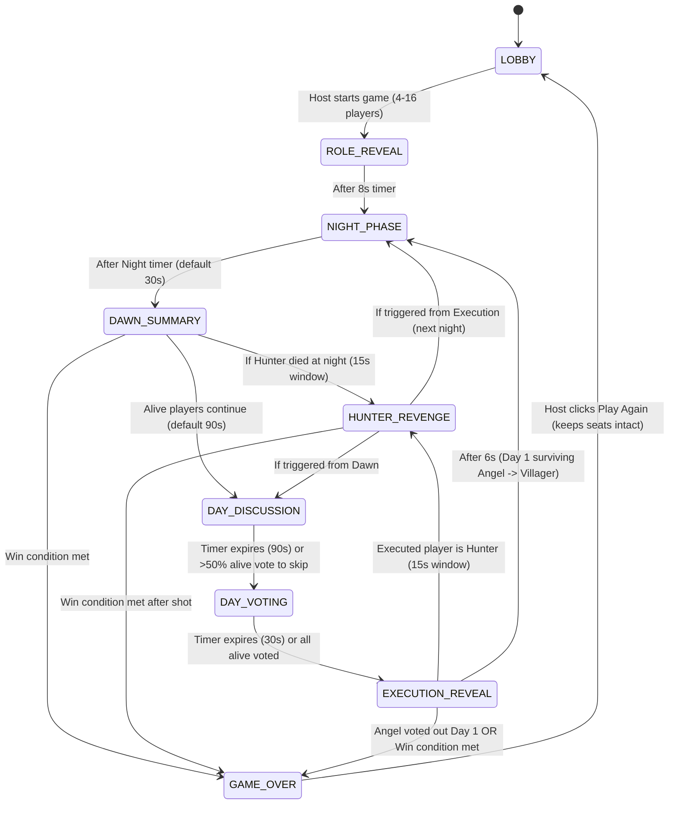

# Campfire Wolves — Architecture & Technical Specification

## 1. System Overview

**Campfire Wolves** is a full-stack, real-time multiplayer social deduction browser game for **4 to 16 players** inspired by *Agrou* / *Werewolf*. The architecture separates an authoritative Node.js + Express + Socket.io backend (`/server`) from a reactive Vite + React + TypeScript + Tailwind CSS + Framer Motion frontend (`/client`) inside a TypeScript monorepo.

```text
agrou/
├── ARCHITECTURE.md           # State machine, deck-builder algorithm, socket contracts & security
├── README.md                 # Setup, deployment & gameplay documentation
├── package.json              # Root workspace scripts (dev, test, lint, build)
├── server/                   # Authoritative Node.js + Express + Socket.io backend
│   ├── src/
│   │   ├── index.ts          # Express health/role endpoints + Socket.io entrypoint
│   │   ├── types/game.ts     # Authoritative & sanitized domain types
│   │   ├── constants/        # Quota table & 20-role registry (Normal, Qatil, Tərəfsiz)
│   │   ├── engine/           # RoomManager, GameEngine, StateSanitizer, ChatAuthorization, WinConditionChecker
│   │   │   └── roles/        # Strategy pattern per role + deterministic NightResolver
│   │   └── socket/           # Socket.io event handlers & WebRTC signaling
│   └── tests/engine.test.ts  # Vitest unit tests (4-16 deck builder, roles, anti-cheat, chat)
└── client/                   # Vite + React + TypeScript + Tailwind + Framer Motion UI
    └── src/
        ├── App.tsx           # Socket lifecycle, phase headers & layout
        ├── constants/        # Role catalog & client quota preview helpers
        ├── components/       # CampfireArena (4-16 radial scaling), LobbyConfigPanel, ChatPanel, etc.
        └── services/         # Web Audio synthesizer & sessionStorage reconnection helper
```

---

## 2. Deterministic Game State Machine

All phase transitions, countdown timers, vote tallies, deck generation, and night action resolutions execute **exclusively on the server**. Each room maintains an authoritative `RoomState` and server-managed timers in `RoomManager`.

### Phase State Diagram



### Phase Specifications

| Phase | Default Duration | Server Responsibilities | Client Experience |
| :--- | :--- | :--- | :--- |
| `LOBBY` | Indefinite | Generate 5-char room code, manage 4–16 seats/avatars/bots, store boolean special role `ON/OFF` toggles & timers, preview faction quota breakdown. | Copyable invite URL, avatar/color picker, live `Normal / Qatil / Tərəfsiz` quota preview, `ON/OFF` role switches, timer sliders. |
| `ROLE_REVEAL` | `8s` | Execute `buildRoleDeck(playerCount, enabledToggles)`, cryptographically deal 1 role per seat, reset potion/infection/douse state, `dayNumber = 1`. | 3D card-flip revealing Role, Faction (`Normal`, `Qatil`, or `Tərəfsiz`), ability description, and win condition. |
| `NIGHT_PHASE` | `30s` (configurable) | Route private `wolves` chat (with anonymized Little Girl peeking) and `lovers` chat, accept Qatil pack votes + Black/Mystic Wolf actions, Guard protect, Seer inspect, Witch heal/poison, Crow curse, Night 1 Cupid link & Wild Child model selection, White Wolf odd-even night betrayal, Arsonist douse/ignite. | Deep indigo moonlight theme; sleeping campfire for passive villagers; interactive radial target selectors and action bars for night-active roles. |
| `DAWN_SUMMARY` | `8s` | Resolve night actions via `NightResolver`, apply Elder 2-hit night armor, Heartbreak cascades, Wild Child transformations, Bear Tamer adjacency growl, and Crow penalty tag; announce casualties (respecting `revealDeadRoles`), trigger 15s `HUNTER` shot if killed, check win conditions. | Sunrise transition, dawn rooster audio cue, casualty banner, bear growl & transformation notices. |
| `DAY_DISCUSSION` | `90s` (configurable) | Route alive messages to `public` (and alive Lovers to `lovers`), dead messages to `dead` Ghost Chat; transition early when `>50%` of alive players vote to skip. | Warm amber campfire theme, tabbed chat (`public` / `lovers` / `dead`), typing/PTT speaking badges, skip-to-vote button. |
| `DAY_VOTING` | `30s` (configurable) | Record elimination target or `SKIP` per alive player, include Crow `+2` penalty votes, mask live vote tallies if Shadow Wolf activates `day:shadowHideVotes`, resolve plurality (ties or skip plurality = no elimination). | Radial seat voting with live vote badges (`🙈 Gizli` during Shadow blackout) + `Skip Vote` button. |
| `EXECUTION_REVEAL` | `6s` | Eliminate winning candidate, reveal role (if `revealDeadRoles`), check Day 1 `ANGEL` win & any-day `JESTER` win, wipe Normal special powers if `ELDER` is executed, trigger 15s revenge shot for `HUNTER` or `VENGEFUL_WOLF`, convert surviving Day 1 `ANGEL` to `VILLAGER` before Night 2, evaluate win conditions. | Gavel sound cue, execution summary card, Hunter/Vengeful Wolf interrupt if triggered. |
| `GAME_OVER` | Indefinite | Unmask all roles, compute MVP awards, allow Host to reset the room back to `LOBBY`. | Full role reveal, winning team/solo banner, MVP cards, Play Again button. |

---

## 3. Automatic Faction Distribution & Deck-Builder Algorithm (`4–16` Players)

In the Lobby, the host **cannot** configure arbitrary role counts. Every special role is a boolean **`ON / OFF` toggle** with a strict **maximum of 1 copy per match**. Only base **Villager** (`VILLAGER`) and base **Werewolf** (`WEREWOLF`) can appear more than once.

### Automatic Faction Quota Table

| Players ($N$) | Normal (Village) | Qatil (Killers) | Tərəfsiz (Neutral) | Total |
| :---: | :---: | :---: | :---: | :---: |
| **4** | 3 | 1 | 0 | 4 |
| **5** | 4 | 1 | 0 | 5 |
| **6** | 4 | 1 | 1 | 6 |
| **7** | 5 | 1 | 1 | 7 |
| **8** | 5 | 2 | 1 | 8 |
| **9** | 6 | 2 | 1 | 9 |
| **10** | 6 | 2 | 2 | 10 |
| **11** | 7 | 2 | 2 | 11 |
| **12** | 7 | 2 | 3 | 12 |
| **13** | 8 | 3 | 2 | 13 |
| **14** | 9 | 3 | 2 | 14 |
| **15** | 9 | 3 | 3 | 15 |
| **16** | 10 | 3 | 3 | 16 |

### `buildRoleDeck(playerCount, enabledToggles)` Algorithm

1. **Quota Lookup:** Look up `(normalQuota, qatilQuota, terefsizQuota)` for `playerCount ∈ [4..16]`.
2. **Tərəfsiz Slots:**
   - Filter enabled roles from `['ANGEL', 'JESTER', 'WILD_CHILD', 'WHITE_WOLF', 'ARSONIST']` (max 1 each).
   - Cryptographically shuffle the enabled pool and take up to `terefsizQuota` unique roles.
   - If fewer `Tərəfsiz` roles are toggled `ON` than `terefsizQuota`, add the shortage `(terefsizQuota - pickedTerefsiz.length)` directly into `normalQuota` so the total deck still equals $N$.
3. **Qatil Slots:**
   - Filter enabled special roles from `['BLACK_WOLF', 'MYSTIC_WOLF', 'VENGEFUL_WOLF', 'SHADOW_WOLF']` (max 1 each).
   - Cryptographically shuffle the enabled pool and take up to `qatilQuota` unique roles.
   - Fill all remaining `qatilQuota` slots with base `'WEREWOLF'` cards.
4. **Normal Slots:**
   - Filter enabled special roles from `['ELDER', 'BEAR_TAMER', 'CROW', 'CUPID', 'SEER', 'WITCH', 'GUARD', 'HUNTER', 'LITTLE_GIRL']` (max 1 each).
   - Cryptographically shuffle the enabled pool and take up to `normalQuota` unique roles.
   - Fill all remaining `normalQuota` slots with base `'VILLAGER'` cards.
5. **Deal:** Cryptographically shuffle all $N$ cards using Fisher-Yates backed by `crypto.randomInt` and deal 1 role per seated player.

---

## 4. Playable Roles & Deterministic Night Resolution

### Role Catalog (20 Roles: 2 AUTO-FILL + 18 Toggleable Specials)
- **Normal (`VILLAGE` — 10 Roles):** `VILLAGER` (`AUTO-FILL`), `ELDER`, `BEAR_TAMER`, `CROW`, `CUPID`, `SEER`, `WITCH`, `GUARD`, `HUNTER`, `LITTLE_GIRL`.
- **Qatil (`WEREWOLF` — 5 Roles):** `WEREWOLF` (`AUTO-FILL`), `BLACK_WOLF` (1x convert pack victim), `MYSTIC_WOLF` (1x/night inspects non-Wolf for special role), `VENGEFUL_WOLF` (15s dying shot if executed by vote), `SHADOW_WOLF` (1x hides live day vote counts during voting).
- **Tərəfsiz (`NEUTRAL` — 5 Roles):** `ANGEL` (Day 1 execution win; becomes `VILLAGER` before Night 2), `JESTER` (wins immediately if executed by vote on any Day), `WILD_CHILD` (starts on Normal team, chooses Role Model Night 1, transforms into `WEREWOLF` if Role Model dies), `WHITE_WOLF` (appears as normal Werewolf to pack; even-night betrayal kill against fellow Qatil; sole-survivor win), `ARSONIST` (`DOUSE` 1 player or `IGNITE` all currently doused players simultaneously; sole-survivor win).

### Night Resolution Priority (`NightResolver.resolve`)
1. **Night 1 Bonds & Curse Setup:** `CUPID` links 2 Lovers (`HEARTBREAK` cascade + `'lovers'` chat), `WILD_CHILD` locks a `roleModelId`, and `CROW` marks `cursedPlayerId` (`+2` next-day penalty votes).
2. **Guard (`GUARD`):** Marks `protectedPlayerIds.add(targetId)`. Validation blocks consecutive protection of the same target.
3. **Qatil Pack Vote (`WEREWOLF`, `BLACK_WOLF`, `MYSTIC_WOLF`, `VENGEFUL_WOLF`, `SHADOW_WOLF`, `WHITE_WOLF`):** Plurality decides `wolfVictimId`. If victim is `ELDER` with `elderLivesRemaining > 1`, pack bite removes 1 armor life instead of killing.
4. **Witch (`WITCH`):**
   - `WITCH_HEAL` (1x): Saves `wolfVictimId` from both death and infection.
   - `WITCH_POISON` (1x): Marks target for lethal poisoning (bypasses Guard and Elder armor).
5. **Black Wolf (`BLACK_WOLF`):** `BLACK_WOLF_INFECT` (1x): If pack target is alive and neither guarded nor healed by Witch, converts the victim into `WEREWOLF` (`faction: 'WEREWOLF'`) instead of killing them.
6. **White Wolf (`WHITE_WOLF`):** On even nights (`nightNumber % 2 === 0`), can mark another living Qatil wolf (`whiteWolfVictimId`) to die (blocked by Guard protection).
7. **Seer (`SEER`) & Mystic Wolf (`MYSTIC_WOLF`):** Inspections resolve immediately when submitted (once per night) so players can use intel cleanly:
   - `SEER` learns target's exact `RoleType`.
   - `MYSTIC_WOLF` learns only a boolean `hasSpecialPower` (`target.role !== 'VILLAGER'`).
8. **Arsonist (`ARSONIST`):**
   - `ARSONIST_DOUSE`: Adds `targetId` to `room.arsonistDousedIds` (persists across nights until Ignited).
   - `ARSONIST_IGNITE`: Marks all currently alive players in `room.arsonistDousedIds` for simultaneous fire elimination (bypasses Guard protection and Elder armor) and clears Ignited targets from the douse list.
9. **Morning Aggregation & Post-Death Cascades:** Applies pending deaths, triggers `HEARTBREAK` Lover cascade, transforms `WILD_CHILD` if Role Model died (with private `'wolves'` pack notice), checks `BEAR_TAMER` circular adjacency for Dawn growl, and increments `nightsSurvived`.

### Win Condition Priority (`WinConditionChecker`)
1. **Day 1 Angel Win (`ANGEL`) & Any-Day Jester Win (`JESTER`):** Executed by village day vote (`dayNumber === 1` for Angel; any `dayNumber >= 1` for Jester).
2. **Mutual Destruction (`NONE`):** `alivePlayers.length === 0`.
3. **Mixed-Faction Lovers Solo Win (`LOVERS`):** `alivePlayers.length === 2` and both are mutual cross-faction Lovers.
4. **White Wolf Solo Win (`WHITE_WOLF`):** `alivePlayers.length === 1` and survivor is `WHITE_WOLF`.
5. **Arsonist Solo Win (`ARSONIST`):** `alivePlayers.length === 1` and survivor is `ARSONIST`.
6. **Normal / Village Win (`VILLAGE`):** `alivePackWolves === 0 && aliveWhiteWolves === 0 && aliveArsonists === 0`.
7. **Qatil / Werewolf Win (`WEREWOLF`):** `aliveWhiteWolves === 0 && aliveArsonists === 0 && !hasAliveMixedLovers && alivePackWolves >= aliveNonPackPlayers`.

---

## 5. WebSocket Event Contracts

### Client → Server Events

| Event Name | Payload Type | Description |
| :--- | :--- | :--- |
| `room:create` | `{ nickname: string; avatar: string; color: string; sessionToken?: string }` | Creates room and assigns sender as Host. |
| `room:join` | `{ roomCode: string; nickname: string; avatar: string; color: string; sessionToken?: string }` | Joins an existing 4–16 seat lobby or restores session via `sessionToken`. |
| `room:reconnect` | `{ roomCode: string; sessionToken: string }` | Restores exact seat, secret role, and authorized chat history on refresh. |
| `lobby:updateConfig` | `{ timers?: Partial<PhaseTimers>; enabledRoles?: Partial<Record<RoleType, boolean>>; allowWebRTC?: boolean; revealDeadRoles?: boolean }` | Host updates boolean special role toggles, phase timers, or `revealDeadRoles`. |
| `lobby:addBot` | `{}` | Host adds an AI bot (up to 16 seats). |
| `lobby:removePlayer` | `{ playerId: string }` | Host removes a player/bot in `LOBBY`. |
| `game:start` | `{}` | Host starts match (`4..16` players required) using `buildRoleDeck`. |
| `game:playAgain` | `{}` | Host resets `GAME_OVER` room back to `LOBBY`. |
| `night:wolfVote` | `{ targetId: string \| null }` | Alive wolf-pack member (including White Wolf) votes on pack victim. |
| `night:action` | `{ actionType: NightActionType; targetId?: string \| null }` | Submits Seer, Guard, Witch, Black Wolf, Mystic Wolf, White Wolf, or Arsonist night action. |
| `night:littleGirlPeek` | `{ peeking: boolean }` | Little Girl toggles spying on `wolves` chat. |
| `day:skipVote` | `{}` | Alive player votes to end `DAY_DISCUSSION` early. |
| `day:shadowHideVotes` | `{}` | Shadow Wolf (`1x/match`) hides live vote tallies during `DAY_VOTING`. |
| `day:vote` | `{ targetId: string \| 'SKIP' \| null }` | Alive player casts elimination vote during `DAY_VOTING`. |
| `hunter:shoot` | `{ targetId: string }` | Dying Hunter or Vengeful Wolf selects target within 15s revenge window. |
| `chat:send` | `{ roomId?: string; content: string; channel?: 'public' \| 'wolves' \| 'lovers' \| 'dead' }` | Sends message on an authorized channel. |
| `chat:typing` / `webrtc:speaking` | `{ isTyping: boolean }` / `{ isSpeaking: boolean }` | Updates campfire seat typing / PTT speaking badges. |
| `webrtc:signal` | `{ toPlayerId: string; signal: unknown }` | Relays peer WebRTC signaling. |

### Server → Client Events

| Event Name | Payload Type | Description |
| :--- | :--- | :--- |
| `room:state` | `SanitizedRoomState` | Individually sanitized state snapshot per connected player. |
| `room:joined` | `{ roomCode: string; playerId: string; sessionToken: string }` | Confirms room membership and persistent `sessionToken`. |
| `room:error` | `{ code: string; message: string }` | Server validation or authorization rejection. |
| `chat:message` | `ChatMessage` | Routed exclusively to authorized sockets (`public`, `wolves`, `lovers`, `dead`, `system`). |
| `night:wolfAlert` | `{ suspicionLevel: number; message: string }` | Alerts wolves when Little Girl's peeking exposure triggers detection. |
| `sound:cue` | `{ cue: SoundCueType }` | Synchronized Web Audio API sound effect trigger. |
| `webrtc:signal` | `{ fromPlayerId: string; signal: unknown }` | Relays peer signaling payload. |

---

## 6. Security Boundaries & Anti-Cheat Design

1. **Strict State Sanitization (`sanitizeStateForPlayer(roomState, playerId)`):**
   - Never broadcasts raw `RoomState`. Every player receives a customized `SanitizedRoomState` where every other player's `role` and `faction` default to `"UNKNOWN"` unless:
     1. `target.id === viewer.id` (self).
     2. Both `viewer` and `target` belong to the Qatil / wolf pack (`WEREWOLF`, `BLACK_WOLF`, `MYSTIC_WOLF`, `VENGEFUL_WOLF`, `SHADOW_WOLF`, `WHITE_WOLF`). **White Wolf (`WHITE_WOLF`) is masked as `"WEREWOLF"` (`"WEREWOLF"` faction) to fellow wolves.**
     3. `roomState.phase === 'GAME_OVER'`.
     4. `!viewer.isAlive` (dead Spectator mode).
   - **Private Intel Isolation:**
     - `knownRoles` (exact inspected roles) are populated only on `SEER`'s private `selfSecret`.
     - `mysticWolfInspections` (`targetId -> boolean`) exposes **only** whether inspected players hold a special Normal/Tərəfsiz power—never their role name—and is sent only to `MYSTIC_WOLF`.
     - `arsonistDousedTargetIds` is sent only to `ARSONIST` (plus dead spectators / `GAME_OVER`).
     - `witchPotions`, `currentWolfTargetId`, `wolfVotes`, `blackWolfInfectionAvailable`, `lastProtectedPlayerId`, `loverPartnerId`, `roleModelId`, `shadowWolfAbilityAvailable`, and `exposureLevel` are strictly scoped to their authorized owners.
2. **Channel Isolation (`ChatAuthorization.ts`):**
   - `public`: Readable by all; writable only by alive players outside `NIGHT_PHASE`.
   - `wolves`: Readable/writable during `NIGHT_PHASE` only by alive wolf-pack members; peeking `LITTLE_GIRL` receives a read-only stream with sender anonymized as `"Canavar ???"`.
   - `lovers`: Readable/writable Day & Night only by the two alive Lovers linked by `CUPID`.
   - `dead`: Readable/writable by eliminated players anytime without living players seeing messages.
3. **Session Security:** Cryptographically random `sessionToken` stored in browser `sessionStorage` prevents seat hijacking on reconnect.
